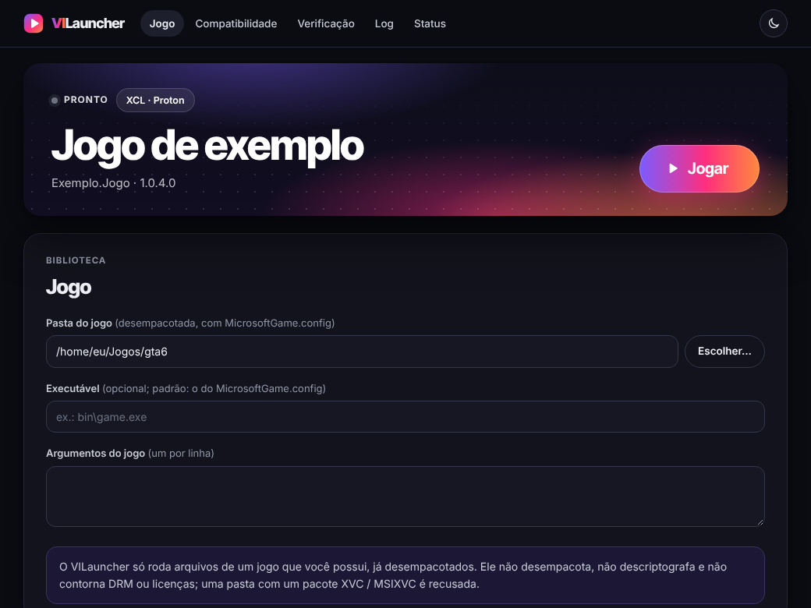
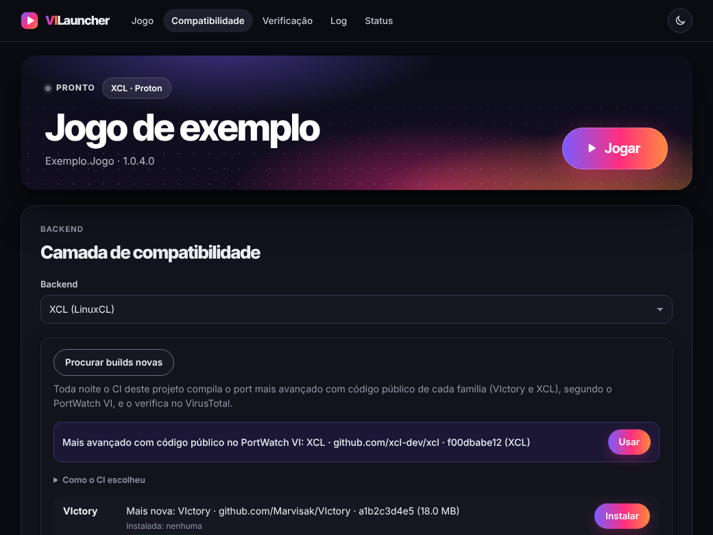
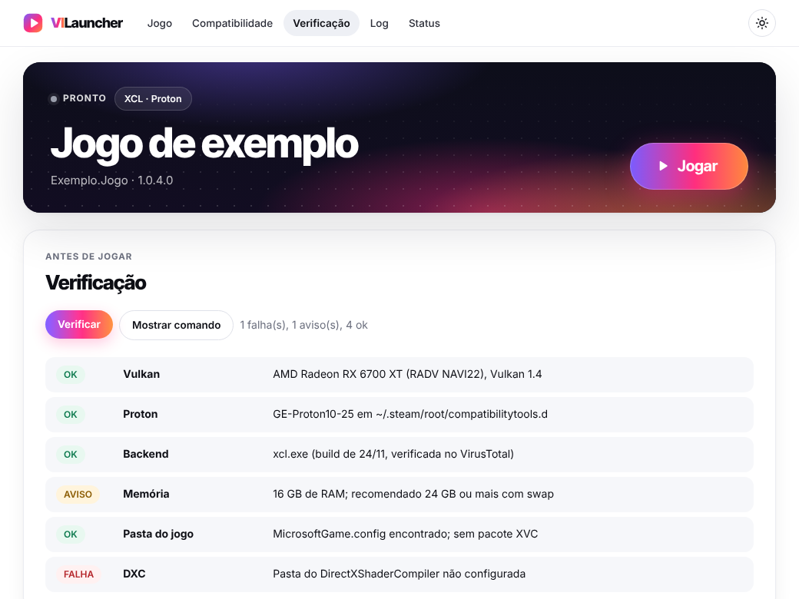

# SixLauncher

**The launcher for the GTA VI PC port.** Grand Theft Auto VI is out on consoles only. The community
ports, [VIctory](https://github.com/Marvisak/VIctory) and its forks, and
[XCL](https://github.com/xcl-dev/xcl), run the game's Xbox Series X|S build on a PC, from a copy of
the game **that you own**. SixLauncher, written in **Rust + Tauri**, sets that up on Linux: it picks
and installs the port, prepares Proton or Wine, checks your machine and runs the game. It also runs
on Windows, where the ports run natively, and (experimentally) on Apple Silicon Macs.

It relies on two outside services:

- **[PortWatch VI](https://portwatch-vi.xyz/)** tracks how far each GTA VI port has got. SixLauncher
  shows that race in the **Status** tab, and
  [builder](https://github.com/SixLauncher/builder) builds every port with
  public code that PortWatch VI scores high enough.
- **[VirusTotal](https://www.virustotal.com/)** scans every build before it is published. The result
  ships with the build as JSON, and SixLauncher checks that JSON before it installs anything.

> [!IMPORTANT]
> SixLauncher is a community project. It is not affiliated with or endorsed by Rockstar Games,
> Take-Two Interactive or Microsoft, and it contains nothing from the game. The ports are work in
> progress: by PortWatch VI's own reports, the game is **not playable yet** on PC.



## Contents

- [What SixLauncher does](#what-sixlauncher-does)
- [Game check (SHA-256)](#game-check-sha-256)
- [What it does not do](#what-it-does-not-do)
- [How it works](#how-it-works)
- [PortWatch VI: where "most advanced" comes from](#portwatch-vi-where-most-advanced-comes-from)
- [VirusTotal: how builds are checked](#virustotal-how-builds-are-checked)
- [Install](#install)
- [First run, step by step](#first-run-step-by-step)
- [The window's tabs](#the-windows-tabs)
- [Command line](#command-line)
- [Configuration and where files go](#configuration-and-where-files-go)
- [Requirements](#requirements)
- [Releases and CI](#releases-and-ci)
- [Building](#building)
- [Project status](#project-status)
- [Code layout](#code-layout)
- [License](#license)

## What SixLauncher does

| What | Where |
|---|---|
| Shows the race between the GTA VI ports: overall progress, the ranking, each project's milestones, highlights and blockers, as PortWatch VI reports them | **Status** tab, `sixlauncher status` |
| Installs a port build compiled by SixLauncher Builder and scanned on VirusTotal; any published build is one click away | **Compatibility › Backend**, `sixlauncher update` |
| Checks every download: size, SHA-256, that the binaries are the ones VirusTotal scanned and that none was flagged | when installing |
| Checks the game's executable against the known SHA-256 | **Game**, `sixlauncher verify` |
| Finds Steam's Proton (or GE-Proton), or uses the system's Wine with vkd3d-proton | **Compatibility** |
| Downloads, lists, picks and removes GE-Proton versions without Steam, checking each download's size and SHA-512 | **Compatibility › Proton versions**, `sixlauncher proton` |
| Keeps the last 3 builds each update replaced and rolls back to one with a click, even offline | **Compatibility › Previous builds**, `sixlauncher rollback` |
| Prepares the Wine prefix and passes the port the variables it documents | **Compatibility › Prepare prefix**, when playing |
| Picks the GPU that runs the game (PRIME offload on NVIDIA hybrid laptops, DRI_PRIME elsewhere) and applies a variable profile for NVIDIA, AMD or Intel | **Compatibility › GPU and overlay**, `sixlauncher gpus`, `setup --gpu --gpu-profile` |
| Turns on MangoHud (FPS, frame time, GPU and CPU load, FPS limit) and GameMode, and says when they are not installed on the system (a Flatpak extension alone does not do, as the game runs outside the Flatpak) | **Compatibility › GPU and overlay**, `setup --mangohud --gamemode --fps-limit` |
| Checks the machine and the configuration before playing: CPU, GPU and Vulkan, mesh shaders, memory, kernel settings, paths | **Check** tab, `sixlauncher doctor` |
| Fixes the kernel settings the check warns about (`vm.max_map_count`, `vm.unprivileged_userfaultfd`) in one click: writes `/etc/sysctl.d/80-sixlauncher-*.conf` and applies it, asking for the password through pkexec (from the Flatpak, on the system through `flatpak-spawn --host`) | **Check › Fix**, `sixlauncher fix` |
| Packs into a .zip the checks, the configuration, the system and the logs of the launcher, Proton, vkd3d-proton and the port (plus the prefix's crash dumps), to send to the developers | **Log › Export .zip**, `sixlauncher report` |
| Runs the game and shows its output live, also written to a file | **Play**, **Log** tab, `sixlauncher run` |
| Looks up the build in use on VirusTotal with your own key (optional) | **Compatibility**, `sixlauncher virustotal` |
| Creates an applications-menu shortcut | **Create menu shortcut**, `sixlauncher desktop` |
| Light and dark themes, keyboard shortcuts and 15 languages | top of the window |

The two port families ("backends"):

| Backend | Repository | What it is |
|---|---|---|
| `victory` | [VIctory](https://github.com/Marvisak/VIctory) and its forks | a runtime made for Grand Theft Auto VI |
| `xcl` | [XCL](https://github.com/xcl-dev/xcl) | a general layer for Xbox GDK titles, which also runs GTA VI |

SixLauncher Builder builds the forks of both families that score high enough on PortWatch VI (see
below), and you choose which one to install.

## Game check (SHA-256)

With **Game › Verify the game's executable** on (the default), SixLauncher computes the SHA-256 of
the game's executable when the folder changes, and in the **Check** tab before playing, and compares
it with the known one:

| File | SHA-256 |
|---|---|
| executable | `e95020b2fa4a721db3df59fdecf75621730ac559d8835252f6c3b658d5a08993` |
| `.zip` | `7545a2f7fb4b399cf8850987f087ed9a4d8499ddb6d6c2d642fd60c27f569730` |

A mismatch is a warning, not an error: it can be another version of the game, or a changed or damaged
file. The result is kept in `~/.cache/sixlauncher/hashes.json` with the file's size and modification
time, so a large executable is hashed again only when it changes. **Verify a .zip…** (or
`sixlauncher verify file.zip`) checks the `.zip`. The values live in `crates/core/src/integrity.rs`.

## What it does not do

- It does not download any of the game's files.
- It does not unpack or decrypt packages (XVC / MSIXVC). It refuses a folder that holds a package.
- It does not get around DRM, anti-cheat or licensing.
- It ships nothing from the game or the console SDK, and no Rockstar logo, artwork, font or image.
- It does not build or run the ports' source code on your machine. Third-party code is compiled only
  by SixLauncher Builder, and what reaches you is the binary that went through VirusTotal.

It only runs the **already unpacked** folder of a copy of the game you own.

## How it works

VIctory and XCL are **Windows** programs (`victory.exe`, `xcl.exe`). Each loads the console
executable into its own process, implements the console's libraries (`kernelx`, XGameRuntime,
D3D12.X and others) and recompiles the RDNA2 shaders to DXIL. Neither builds for Linux.

Both already support Wine explicitly: they detect it (`wine_get_version`) and change their behaviour
under it, and XCL's D3D12 code was written with vkd3d-proton in mind. So on Linux the chain is:

```
GTA VI (console x86-64 code) ─► victory.exe / xcl.exe ─► Proton or Wine ─► vkd3d-proton (D3D12 → Vulkan) ─► GPU
```

The game's x86-64 code runs directly on the CPU, with no emulation. SixLauncher puts that chain
together:

1. finds Proton, or uses the system's Wine with vkd3d-proton copied into the prefix;
2. prepares the prefix (`wineboot`);
3. turns Linux paths into the ones the program sees under Wine (`/home/you/gta6` becomes
   `Z:\home\you\gta6`);
4. passes each port its variables: data and cache folders, console (Series X or S), DXC, Opus and
   whatever you put in `[env]`;
5. checks the machine and the configuration;
6. runs the game and records its output.

## PortWatch VI: where "most advanced" comes from

[PortWatch VI](https://portwatch-vi.xyz/) ([source](https://github.com/4lwayz/portwatch-vi)) is an
independent site that follows the GTA VI port projects. It keeps everything in one file,
[`data/tracker.json`](https://github.com/4lwayz/portwatch-vi/blob/main/data/tracker.json), which
SixLauncher uses in two ways.

### 1. In the Status tab


The **Status** tab (`Ctrl+5`) reads `tracker.json` and shows:

- **Overall progress:** the score of the project closest to playable, on the site's 0–100 % scale.
  The milestones are a ladder up to **Playable** at 50 %: Groundwork, Exe running (10 %), First frame
  (20 %), Main menu (30 %), In the world (40 %) and Playable (50 %). After that, story, rendering,
  performance and stability fill the rest up to **Complete** (100 %).
- Four figures: the furthest milestone, the top-3 average, how many projects boot GTA VI and how many
  are tracked.
- One bar with the leading projects marked on it, and a chart of the leader's score day by day.
- **The race:** a card per project with its avatar, repository, backend, stage, score, milestone bar,
  highlights and blockers, ordered by percentage, highest first, as on the site.

Avatars are the site's own image for a private build, or the repository owner's GitHub avatar. The
Rust core downloads them, not the page; it accepts only PNG, JPEG, GIF or WebP up to 512 KB (checked
by their first bytes) and keeps each one for a week in `~/.cache/sixlauncher/avatars`.

The last copy of `tracker.json` is kept in `~/.cache/sixlauncher/portwatch-tracker.json`. Offline, the
tab shows that copy and says it is out of date. **Refresh** fetches it again. In a terminal:
`sixlauncher status`.

The stages are the site's estimates, and many are reported by the projects themselves. SixLauncher
only **reads** this data.

### 2. Choosing what gets built (SixLauncher Builder)

[builder](https://github.com/SixLauncher/builder), a service on Railway that
runs **every 3 hours**, reads the same `tracker.json` and:

1. scores every project the way the site does (0–100);
2. keeps those with public code that reach the minimum score;
3. builds each one that is a **VIctory** tree (has `apps/victory/Cargo.toml`) or an **XCL** tree (has
   `crates/xcl/Cargo.toml`), at the newest commit of its default branch, for Windows from Linux
   (cargo-xwin, MSVC target);
4. skips, with the reason, repositories that are gone (404 or DMCA), archived or of another kind, and
   never rebuilds a commit already published.

The result goes into `runtimes.json`: the best build of each family, the list of all builds (with
their score) and every candidate with the reason it was taken or skipped. The window lists them under
**Compatibility › Backend**, where any published build installs with one click.

## VirusTotal: how builds are checked

### In SixLauncher Builder, for every build

After building, the service runs `virustotal-scan.py` with its own `VT_API_KEY`:

1. **Finds the executables by content, not by name:** Windows PE (`.exe`, `.dll`, `.sys`), Linux ELF
   (programs, `.so`, AppImage), `.deb` packages, MSI installers, Mach-O and `#!` scripts. The whole
   folder is walked, and symbolic links are ignored.
2. **Looks each file up by SHA-256,** and uploads it only when VirusTotal does not know it yet. Files
   over 32 MB go through a dedicated upload URL.
3. **Writes the result into `runtimes.json`** with the build: the repository and commit and, for each
   file, its name, SHA-256, how many engines flagged it as malicious or suspicious, the number of
   engines and a link to the report. The build's verdict is `clean`, `flagged`, `pending`, `skipped`
   or `error`.
4. **Does not publish a flagged build.** If only an extra program of a port is flagged (not the one
   SixLauncher runs), that program is left out of the archive and listed under `dropped`.

**Free key limits.** The free API allows 4 lookups a minute, 500 a day and 15.5 thousand a month, for
non-commercial use only. The service spaces lookups 16 s apart, makes at most 60 per run (the rest
stay `pending`) and does not scan a published build again.

**To turn it on:** create a free VirusTotal account, copy the API key and set it as the service's
`VT_API_KEY` variable on Railway (see SixLauncher Builder's README). Without a key, builds are
published as "not scanned".

### In SixLauncher, when installing

When you install a build from the **Backend** list, SixLauncher checks its JSON before switching:

- it refuses a build whose verdict is `flagged`;
- it checks that every scanned file exists in the build with the same SHA-256, so a binary other than
  the one that was scanned makes the install fail;
- it accepts no file name that points outside the build's folder.

### On your machine (optional)

You can also save your own key in **Compatibility › Save key** (or
`sixlauncher virustotal --key KEY`). It is kept in `~/.config/sixlauncher/virustotal.key`, readable only
by you, or it can come from the `SIXLAUNCHER_VT_KEY` variable. With a saved key:

- SixLauncher looks every build up again before installing it;
- **Check the current build on VirusTotal** (`sixlauncher virustotal`) looks up the build in use, even
  one you compiled yourself. Executables are recognised by content, as in SixLauncher Builder;
- only the hash leaves your machine. A whole file is uploaded only when you ask for **Send for
  analysis** (`sixlauncher virustotal --upload xcl.exe`);
- only the binaries in the backend's folder are looked up or uploaded, never the game folder.

An antivirus scan does not prove a program is harmless. The ports are chosen by an independent site's
ranking, and VirusTotal is one more layer of care, not a guarantee.

## Install

Every merge into `main` publishes a [release](https://github.com/SixLauncher/launcher/releases/latest)
with every package. Pick the one for your distribution:

| Distribution | Package | How to install |
|---|---|---|
| Ubuntu, Debian, Mint, Pop!_OS, Zorin | `.deb` | `sudo apt install ./SixLauncher_*_amd64.deb` |
| Fedora, openSUSE, Nobara, RHEL | `.rpm` | `sudo dnf install ./SixLauncher-*.x86_64.rpm` (openSUSE: `sudo zypper install ./…rpm`) |
| Arch, Manjaro, EndeavourOS, CachyOS | `PKGBUILD` | `cd packaging/arch && makepkg -si` (builds the release from source) |
| Steam Deck (SteamOS), Bazzite and any distro with Flatpak | `.flatpak` | `flatpak install --user ./sixlauncher.flatpak` |
| Any x86-64 distro | AppImage | `chmod +x SixLauncher_*.AppImage && ./SixLauncher_*.AppImage` |
| Any x86-64 distro | `.tar.gz` | unpack it and run `sixlauncher-app` |

The `.deb`, `.rpm` and AppImage are built on Ubuntu 22.04, so they need glibc 2.35 or newer. The Arch
package uses the system's `webkit2gtk-4.1`, and the Flatpak uses the GNOME 50 runtime's.

**In the Flatpak** the launcher runs inside the sandbox, but Proton and Wine run on the system: it
starts them with `flatpak-spawn --host`. So:

- the Flatpak asks for access to your home folder, where the game, Steam's Proton and the Wine prefix
  live;
- it also asks for access to `org.freedesktop.Flatpak`, which is what lets it run programs on the
  system;
- use Proton (Steam's or GE-Proton), because a Wine installed in `/usr` is not visible inside the
  sandbox;
- the menu shortcuts it creates call `flatpak run`;
- it updates itself: **Update** downloads the release's `sixlauncher.flatpak`, checks its signature
  (the same key as the other packages) and installs it with the system's `flatpak install`, in the
  installation it runs from (`--user`, or `--system`, which may ask for your password).

### macOS (Apple Silicon, experimental)

Every release also carries `SixLauncher_<version>_aarch64.dmg` (the app) and
`sixlauncher-macos-arm64.tar.gz` (the CLI). On a Mac, GTA VI runs under Wine with Apple's D3DMetal,
through Rosetta 2, with [VIctory for macOS](https://github.com/romainhedouin/VIctory-macOS) builds:

- **Wine:** install CrossOver (26 or newer) or Apple's Game Porting Toolkit; SixLauncher looks for both
  in their usual places (`/Applications/...`), or point it at the `wine` binary yourself. D3DMetal must
  be 4.0 or newer. Proton does not exist on macOS.
- **D3D12:** SixLauncher uses Wine's own D3D12 (`WINEDLLOVERRIDES=d3d12,d3d12core,dxgi=b`), which
  D3DMetal serves; there is no vkd3d-proton.
- **Builds:** the **Backend** list shows only builds made for macOS; on Linux they do not appear.
- **Check:** the Linux checks (kernel, Vulkan, GPU, MangoHud, GameMode) do not run on a Mac.
- **First launch:** the app is not signed or notarized with an Apple Developer ID. Open it with
  right-click › **Open**, or run `xattr -dr com.apple.quarantine /Applications/SixLauncher.app`.
- Self-update does not cover the Mac yet: download the new release by hand.

### Windows (x64)

Every release also carries `SixLauncher_<version>_x64-setup.exe` (the installer) and
`sixlauncher-windows-x64.zip` (the window, `sixlauncher-app.exe`, and the CLI, `sixlauncher.exe`, with
nothing to install). On Windows the ports are what they already are, Windows programs, so they run
**natively**:

- **Runner:** `native`, the only one offered on Windows (and the default there). There is no Proton,
  no Wine, no vkd3d-proton and no prefix: D3D12 is the GPU driver's own. Proton and Wine are refused
  on Windows, and `native` everywhere else.
- **Builds:** the **Backend** list offers the same VIctory and XCL builds as on Linux.
- **Check:** the platform and AVX2 checks run; the Linux ones (kernel settings, Vulkan, GPU offload,
  MangoHud, GameMode) do not, and those options are hidden.
- **Installer:** per user, no administrator rights; it installs Microsoft Edge WebView2 if it is
  missing (Windows 10 and 11 already have it). It is not Authenticode-signed, so SmartScreen warns the
  first time: **More info › Run anyway**.
- **Self-update:** the installed copy updates itself from the window when the release is signed (it
  runs the new installer and closes while it works). The `.zip` is told where to download.
- **Menu shortcut:** **Create menu shortcut** puts `<game> (SixLauncher).lnk` in the Start menu.

## First run, step by step

1. **Install Proton.** The easiest way is from the window: **Compatibility › Proton versions › Find
   GE-Proton › Download and use** (or `sixlauncher proton install latest --use`), no Steam needed. If
   Steam already has *Proton Experimental*, it shows in the same list. With the system's Wine, also
   download a [vkd3d-proton](https://github.com/HansKristian-Work/vkd3d-proton/releases) release.
2. **Open SixLauncher** from the applications menu, or run `sixlauncher-app`.
3. **Game tab:** click **Browse…** and pick the **unpacked** folder of your copy of GTA VI.
   SixLauncher finds the executable and checks its SHA-256. Add arguments if needed and click **Save**.
4. **Compatibility › Backend:** the list holds the builds SixLauncher Builder published, highest score
   first (for example "Belobug · VIctory · 77.4%"). Pick one: it is downloaded, checked and becomes
   the backend in use. Below it are its VirusTotal result, **Update** when the same project has a newer
   commit, and the previous builds, to go back.
   - If you built `victory.exe` or `xcl.exe` yourself, pick **Your own executable** and point the
     backend executable at it.
5. **Still in Compatibility:** choose Proton (or Wine and the vkd3d-proton folder) and click **Prepare
   prefix**.
6. **Check tab** (`Ctrl+D`): see what passes, what warns and what fails, each with its suggested fix.
   **Show command** shows the exact command and environment that will run.
7. **Play** (`Ctrl+Enter`). The output shows live in the **Log** tab. **Stop** ends the game and the
   prefix's `wineserver`.
8. Optionally, click **Create menu shortcut**.

**Play** refuses to run while a configuration check fails, but **Run anyway** forces it.

## The window's tabs

| Tab | Shortcut | What it holds |
|---|---|---|
| **Game** | `Ctrl+1` | the game folder, the executable, the arguments and the SHA-256 check |
| **Compatibility** | `Ctrl+2` | the **Backend** list (the published builds, with project, commit and VirusTotal badge), **Look for new builds**, **How the builds were chosen**; Proton or Wine; vkd3d-proton, DXC and Opus; GPU and overlay; the VirusTotal key |
| **Check** | `Ctrl+3` | the machine and configuration checks, **Fix** on the kernel warnings (it shows what it will write, the userfaultfd risk and the commands to do it by hand) and the exact command that will run |
| **Log** | `Ctrl+4` | the game's live output, also written to `~/.local/state/sixlauncher/last-run.log`; **detailed logs** (`PROTON_LOG=1`, or `VKD3D_DEBUG`/`WINEDEBUG` with Wine) and the **.zip report** for the developers, with your home folder's path replaced by `~` |
| **Status** | `Ctrl+5` | the overall progress and the race between the ports, from PortWatch VI; notifications |

### Notifications

While the window is open, SixLauncher checks every hour (and half a minute after it opens) whether
something changed, and tells you through the system's notifications, in the window's language:

- **Overtakes in the race:** a project passed another among PortWatch VI's top 5 (tracked, live
  projects only). If it took the lead, the notification says so.
- **New VIctory and XCL builds:** SixLauncher Builder published a build you have not installed yet. A
  build VirusTotal flagged is never announced.
- **New SixLauncher versions:** a new release of the launcher is out (once per version).

Each kind can be turned off at the bottom of the **Status** tab, and **Send a test** shows whether the
system lets SixLauncher notify. The first time, it only notes how things stand, without notifying;
what it saw last is kept in `~/.local/state/sixlauncher/notifications.json`. A kind that is off is
still noted, so turning it back on brings no old news. Offline, the saved copy of PortWatch VI does
not count as news.

The theme follows the system's until you pick light or dark with the button at the top; the choice is
saved.

The window opens in the system's language (Linux's `LANG` / `LANGUAGE`) and can be switched next to
the theme button; that choice is saved too. There are 15 languages, the most spoken in the world:
English, Chinese (Simplified), Hindi, Spanish, Arabic, French, Bengali, Portuguese (Brazil), Russian,
Urdu, Indonesian, German, Japanese, Turkish and Korean. Arabic and Urdu turn the window right to left;
bars, charts, paths and the log stay left to right. The checks' technical details and error messages
come from the core in English, and the projects' texts come from PortWatch VI as they are.

To add or fix a translation, edit `ui/locales/<language>.js` (Portuguese, `pt-BR.js`, is the
reference with every key) and run `node scripts/check-locales.js`, which checks every language's keys
and `{placeholders}`; CI runs the same.

| Compatibility | Check (light theme) |
|---|---|
|  |  |

## Command line

The window and the CLI (`sixlauncher`) share the same core and configuration file. The CLI is for
scripts, menu shortcuts and SSH.

```sh
# Proton (found automatically) + VIctory
sixlauncher setup --game ~/Games/gta6 --backend-exe ~/builds/victory.exe

# or the system's Wine + vkd3d-proton + XCL
sixlauncher setup --game ~/Games/gta6 --backend-exe ~/builds/xcl/xcl.exe \
    --runner wine --vkd3d ~/Downloads/vkd3d-proton-2.14 --dxc-dir ~/dxc/bin/x64 --opus-dir ~/opus

sixlauncher doctor                         # check the machine and the configuration
sixlauncher verify [FILE]                  # the game executable's SHA-256 (or the .zip's) against the known one
sixlauncher fix [--print]                  # fix the kernel settings that warn (asks for the password)
sixlauncher report [file.zip]              # the .zip with checks, system and logs for the developers
sixlauncher run --dry-run                  # show the command and environment without running
sixlauncher run                            # play
sixlauncher run -- -argument               # arguments for the game
sixlauncher desktop                        # create the applications-menu entry

sixlauncher status                         # the race between the ports, from PortWatch VI
sixlauncher update                         # the published builds and the installed one of each backend
sixlauncher update best                    # install the most advanced family's build and use it
sixlauncher update xcl|victory [--force]   # install a backend's best build (--force reinstalls)
sixlauncher update victory --build Belobug # install another published build (project, repository or archive)
sixlauncher rollback victory               # list the builds updates replaced
sixlauncher rollback victory last          # go back to the previous one (or pass the commit)

sixlauncher protons                        # every Proton found (Steam's and the launcher's)
sixlauncher proton available               # GE-Proton releases on GitHub
sixlauncher proton install latest --use    # download the newest (SHA-512 checked) and use it
sixlauncher proton use GE-Proton10-25      # pick an installed Proton
sixlauncher proton remove GE-Proton10-20   # delete a Proton the launcher downloaded

sixlauncher virustotal                     # look up the build in use on VirusTotal (needs your key)
sixlauncher virustotal --key KEY           # save the key
sixlauncher virustotal --upload xcl.exe    # upload one of the backend's binaries for analysis
```

## Configuration and where files go

The configuration lives in `~/.config/sixlauncher/config.toml`, or in `$SIXLAUNCHER_CONFIG`. The window
and the CLI read and write the same file. On Windows, `~/.config/sixlauncher` is
`%APPDATA%\io.github.lportvi.sixlauncher`, and the other folders below (`~/.local/share/sixlauncher`,
`~/.cache/sixlauncher`, `~/.local/state/sixlauncher`) are `%LOCALAPPDATA%\io.github.lportvi.sixlauncher`,
its `cache` and its `state` subfolders.

```toml
[game]
dir = "/home/you/Games/gta6"
args = []
verify = true                 # check the executable's SHA-256 (false turns it off)

[backend]
kind = "victory"              # or "xcl"
exe = "/home/you/builds/victory.exe"
console = "series-x"          # victory: or "series-s"
unimplemented = "trap"        # victory: or "zero"

[runner]
kind = "proton"               # or "wine"; "native" on Windows
path = "/home/you/.steam/root/compatibilitytools.d/GE-Proton10-1"

[dirs]

[notifications]               # system notifications; all on by default
race = true                   # overtakes in PortWatch VI's race
runtimes = true               # new VIctory and XCL builds
app = true                    # new SixLauncher versions

[env]
VICTORY_LOG = "info"          # any extra variable for the run
```

| What | Where |
|---|---|
| configuration | `~/.config/sixlauncher/config.toml` |
| VirusTotal key (optional) | `~/.config/sixlauncher/virustotal.key` |
| Proton / Wine prefix | `~/.local/share/sixlauncher/compatdata` / `prefix` |
| builds installed by the launcher | `~/.local/share/sixlauncher/runtimes/<backend>` (with `SIXLAUNCHER_SOURCE.json`: project, commit and VirusTotal result) |
| previous builds (the last 3 of each backend) | `~/.local/share/sixlauncher/runtimes/previous/<backend>/<commit>` |
| Proton versions the launcher downloaded | `~/.local/share/sixlauncher/protons/<name>` |
| the game's saves, settings and logs | `~/.local/share/sixlauncher/<backend>/data` (`VICTORY_DATA_DIR`, `XCL_DATA_ROOT`) |
| shader cache and converted data | `~/.cache/sixlauncher/<backend>` (`VICTORY_CACHE_DIR`) |
| SHA-256 results of the game check | `~/.cache/sixlauncher/hashes.json` |
| last copy of PortWatch VI and the avatars | `~/.cache/sixlauncher/portwatch-tracker.json`, `~/.cache/sixlauncher/avatars` |
| output of the last run | `~/.local/state/sixlauncher/last-run.log` |
| what notifications saw last | `~/.local/state/sixlauncher/notifications.json` |

Like VIctory, the launcher refuses data, cache or game folders inside VIctory's tree (`.victory-root`),
so nothing derived from the game ends up in a repository.

Variables for tests or mirrors: `SIXLAUNCHER_TRACKER_URL` (another `tracker.json`),
`SIXLAUNCHER_RUNTIMES_URL` (another `runtimes.json`), `SIXLAUNCHER_GE_PROTON_API` (another list of
GE-Proton releases) and `SIXLAUNCHER_VT_API` (another VirusTotal API).

## Requirements

- x86-64 Linux or Windows and a CPU with AVX2 (or, experimentally, an Apple Silicon Mac: see
  [Install](#install)).
- On Windows: a GPU and driver with D3D12, shader model 6.6 and mesh shaders. The Linux requirements
  below (Vulkan, Proton or Wine, kernel settings) do not apply.
- On Linux: a GPU whose Vulkan driver has `VK_EXT_mesh_shader` (a recent Mesa RADV, or NVIDIA). Both ports need
  shader model 6.6 and mesh shaders, which only vkd3d-proton offers; Wine's own `d3d12` does not.
- **Proton** (GE-Proton, which the launcher downloads by itself, or Steam's Proton Experimental)
  **or** Wine 9+ with an unpacked [vkd3d-proton](https://github.com/HansKristian-Work/vkd3d-proton/releases)
  release.
- Your own copy of GTA VI, unpacked.
- The port. The simplest is to pick a build in the **Backend** list. To build it yourself (on
  Windows):
  - `victory.exe`: `cargo build --release -p victory` in VIctory (its pinned toolchain is
    `x86_64-pc-windows-msvc`);
  - `xcl.exe`: `cargo build --release` in XCL, plus DXC
    ([DirectXShaderCompiler releases](https://github.com/microsoft/DirectXShaderCompiler/releases),
    the `bin/x64` folder with `dxcompiler.dll` and `dxil.dll`) and an `opus.dll` (libopus for
    Windows; without it, Opus audio is silent under Wine). SixLauncher Builder's builds already carry
    all three next to `xcl.exe`.
- Memory: XCL measured about 15 GB committed in the menus of a recent title, so 32 GB (RAM + swap) is
  the safe side.

When they are missing, the check suggests these system settings:

```sh
sudo sysctl -w vm.max_map_count=1048576          # large titles map many regions
sudo sysctl -w vm.unprivileged_userfaultfd=1     # vkd3d-proton must see writes to the game's memory (XCL #175)
```

## Releases and CI

The `build` workflow (`.github/workflows/build.yml`) runs on every push to `main`, on every pull
request and by hand from **Actions › build › Run workflow**. It builds SixLauncher only: VIctory and
XCL come from [builder](https://github.com/SixLauncher/builder).

| Job | What it does |
|---|---|
| `launcher` | builds SixLauncher on Linux: the CLI, the window, `.deb`, `.rpm` and AppImage |
| `flatpak` | builds `sixlauncher.flatpak` (`packaging/flatpak`) |
| `bundle` | packs the CLI and the window into a `.tar.gz` |
| `macos` | builds SixLauncher for macOS on Apple Silicon (`macos-15`): `SixLauncher.app` in a `.dmg`, and the CLI |
| `windows` | builds SixLauncher for Windows x64 (`windows-2022`): the NSIS installer and a `.zip` with the window and the CLI, after a smoke run of `sixlauncher.exe doctor` |
| `release` | on every merge into `main`: publishes a release with every package |

**Launcher releases.** Every merge into `main` publishes a release without a tag having to be made by
hand. The version is `Cargo.toml`'s `<major>.<minor>` plus the workflow's run number (for example
`v0.1.57`), and the packages carry that version. To move to another minor or major, change the
workspace version in `Cargo.toml`. A `v*` tag pushed by hand also publishes, with the tag's version.
On a pull request, the `Release` job only shows what it would publish.

The release holds the `.deb`, the `.rpm`, the AppImage, `sixlauncher.flatpak` and
`sixlauncher-linux-x64.tar.gz` (`sixlauncher`, `sixlauncher-app` and a `BUILD.txt` with the commit), the
macOS `.dmg` and `sixlauncher-macos-arm64.tar.gz`, the Windows `SixLauncher_<version>_x64-setup.exe` and
`sixlauncher-windows-x64.zip`, plus `latest.json` for self-update.

**VIctory and XCL builds.** The launcher downloads them from SixLauncher Builder's `runtimes` release
(`SIXLAUNCHER_RUNTIMES_URL` changes the address). Its `runtimes.json` holds, for each build, the file,
size, SHA-256, repository, commit, PortWatch VI score and VirusTotal result; `victory` and `xcl` are
the best of each family and `builds` lists them all. The archives are uploaded first and
`runtimes.json` last, so the launcher never sees a manifest naming a file that does not exist yet.
Each archive holds the executable at its root (XCL's with DXC and `opus.dll` next to it, which
`xcl.exe` finds by itself), the licenses and a file with the commit.

**Launcher self-update.** When the release is signed (the `TAURI_SIGNING_PRIVATE_KEY` secret), the
AppImage, `.deb`, `.rpm`, the Flatpak and the Windows installer's copy update themselves from the
window, which checks the signature (the `Release` job signs `sixlauncher.flatpak` with the Tauri CLI's
`signer sign`; the other packages are signed where they are built). The tarball, the Windows `.zip`
and builds from source are told about the new version and pointed to the release.

## Building

Tauri's dependencies on Debian/Ubuntu:

```sh
sudo apt install libwebkit2gtk-4.1-dev libgtk-3-dev libsoup-3.0-dev librsvg2-dev build-essential pkg-config
```

To build and test:

```sh
cargo build --release --workspace     # target/release/sixlauncher-app (window) and target/release/sixlauncher (CLI)
cargo test --workspace
```

For the `.deb`, `.rpm` and AppImage packages: `cargo install tauri-cli --version "^2"`, then
`cargo tauri build` inside `app/`. A production build of the window outside `cargo tauri` needs
`--features tauri/custom-protocol`.

On Windows (Rust's MSVC toolchain and the Visual Studio C++ build tools), `cargo build --release
--workspace` builds `sixlauncher-app.exe` and `sixlauncher.exe`, and `cargo tauri build --bundles nsis`
inside `app/` builds the installer. The unit tests drive Proton and Wine through shell scripts, so
they run on Linux; on Windows, `cargo clippy --workspace` checks the code.

The Flatpak:

```sh
flatpak install flathub org.gnome.Platform//50 org.gnome.Sdk//50 org.freedesktop.Sdk.Extension.rust-stable//25.08
flatpak-builder --user --install --force-clean build-dir packaging/flatpak/io.github.lportvi.sixlauncher.yml
```

## Project status

- The core has over 100 tests (`cargo test --workspace`). They use a simulated Proton, a simulated
  Wine prefix, PE headers the tests generate themselves, and local servers standing in for PortWatch
  VI, the release and VirusTotal.
- The window was opened in a virtual X server, where checking, showing the command, playing (with a
  simulated Proton), the live log, the Status tab and installing a build all worked.
- **It has not been tested yet with a real Wine/Proton, GPU and game.** By the ports' own reports,
  GTA VI is **not playable yet** even on Windows: the world renders partly and slowly, and the GPU
  can hang. Running under Wine adds vkd3d-proton's differences on top.
- The Flatpak is built by CI but has not been tried on a Steam Deck yet.

## Code layout

| Folder | What |
|---|---|
| `crates/core` | `sixlauncher-core`: configuration, game folder, Proton/Wine, backends, checks, running, the SHA-256 check (`integrity.rs`), PortWatch VI (`status.rs`, `avatars.rs`), SixLauncher Builder's builds and previous builds (`update.rs`), Proton versions (`protons.rs`), VirusTotal (`virustotal.rs`), what becomes a notification (`notify.rs`), running on the system from the Flatpak (`host.rs`) |
| `crates/cli` | `sixlauncher`: the command line |
| `app` | `sixlauncher-app`: the Tauri 2 window |
| `ui` | the window's interface (HTML, CSS and JS with no build step; all logic stays in Rust) |
| `ui/locales` | the window's translations, one per language (`i18n.js` detects the language and switches) |
| `ui/fonts` | Inter and Inter Tight (SIL Open Font License, `ui/fonts/OFL-*.txt`) |
| `scripts` | `check-locales.js` (checks the translations) |
| `packaging` | menu entry and metainfo (`linux`), Flatpak (`flatpak`) and `PKGBUILD` (`arch`) |
| `.github/workflows` | `build.yml` (builds and releases) and `tests.yml` |
| `docs/screenshots` | screenshots of the window |

## License

GPL-3.0-or-later (`LICENSE`), like VIctory.
