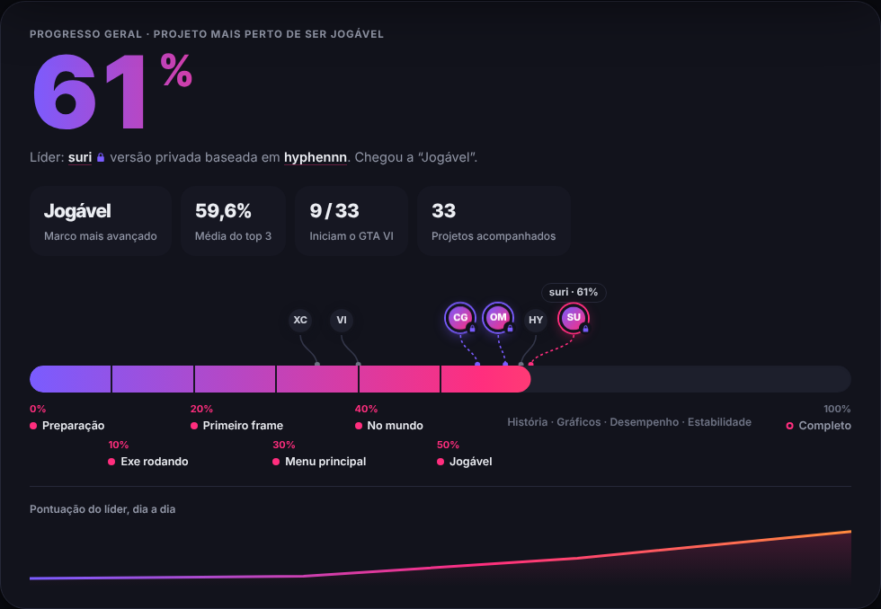

# VILauncher

Launcher para Linux, escrito em **Rust + Tauri**, que roda no Linux um jogo de Xbox Series X|S (GDK)
**que você possui**. Ele usa uma de duas camadas de compatibilidade, o VIctory ou o XCL, por cima
do Proton ou do Wine.

O launcher usa dois serviços externos:

- **[PortWatch VI](https://portwatch-vi.xyz/)** diz quais projetos de port estão mais avançados.
  O launcher mostra esse ranking na aba **Status**, e o
  [vilauncher-builder](https://github.com/SixLauncher/vilauncher-builder) compila os projetos com
  nota 59% ou mais.
- **[VirusTotal](https://www.virustotal.com/)** analisa cada build antes de ela ser publicada. O
  resultado vai num JSON junto da build, e o launcher confere esse JSON antes de instalar.


## Sumário

- [O que o VILauncher faz](#o-que-o-vilauncher-faz)
- [O que ele não faz](#o-que-ele-não-faz)
- [Como funciona](#como-funciona)
- [PortWatch VI: de onde vem o "mais avançado"](#portwatch-vi-de-onde-vem-o-mais-avançado)
- [VirusTotal: como as builds são verificadas](#virustotal-como-as-builds-são-verificadas)
- [Instalar](#instalar)
- [Primeiro uso, passo a passo](#primeiro-uso-passo-a-passo)
- [As abas da janela](#as-abas-da-janela)
- [Linha de comando](#linha-de-comando)
- [Configuração e onde ficam os arquivos](#configuração-e-onde-ficam-os-arquivos)
- [Requisitos](#requisitos)
- [Releases e CI](#releases-e-ci)
- [Compilar](#compilar)
- [Estado do projeto](#estado-do-projeto)
- [Estrutura do código](#estrutura-do-código)
- [Licença](#licença)

## O que o VILauncher faz

| O quê | Onde |
|---|---|
| Mostra a corrida dos ports: o progresso geral, o ranking, os marcos, os destaques e os bloqueios de cada projeto, segundo o PortWatch VI | aba **Status**, `vilauncher status` |
| Instala a build mais nova do backend mais avançado. A build vem compilada pelo vilauncher-builder e verificada no VirusTotal | **Compatibilidade › Backend**, `vilauncher update` |
| Confere cada download: tamanho, SHA-256, se os binários são os que o VirusTotal analisou e se algum foi acusado | ao instalar |
| Acha o Proton do Steam (ou o GE-Proton), ou usa o Wine do sistema com o vkd3d-proton | **Compatibilidade** |
| Baixa, lista, escolhe e remove versões do GE-Proton sem a Steam, conferindo o tamanho e o SHA-512 de cada download | **Compatibilidade › Versões do Proton**, `vilauncher proton` |
| Guarda as 3 últimas builds que cada atualização substituiu e volta para uma delas com um clique, mesmo offline | **Compatibilidade › Builds anteriores**, `vilauncher rollback` |
| Prepara o prefixo Wine e passa para o backend as variáveis que ele documenta | **Compatibilidade › Preparar prefixo**, ao jogar |
| Escolhe a GPU que roda o jogo (em notebooks híbridos liga o PRIME offload da NVIDIA ou o DRI_PRIME) e aplica um perfil de variáveis para NVIDIA, AMD ou Intel | **Compatibilidade › GPU e overlay**, `vilauncher gpus`, `setup --gpu --gpu-profile` |
| Liga o MangoHud (FPS, tempo de quadro, uso de GPU e CPU, limite de FPS) e o GameMode, e avisa se não estão instalados no sistema (uma extensão Flatpak sozinha não serve, porque o jogo roda fora do Flatpak) | **Compatibilidade › GPU e overlay**, `setup --mangohud --gamemode --fps-limit` |
| Verifica a máquina e a configuração antes de rodar: CPU, GPU e Vulkan, mesh shaders, memória, ajustes do kernel, caminhos | aba **Verificação**, `vilauncher doctor` |
| Corrige com um clique os ajustes do kernel que a verificação aponta (`vm.max_map_count`, `vm.unprivileged_userfaultfd`): grava em `/etc/sysctl.d/80-vilauncher-*.conf` e aplica na hora, pedindo a senha pelo pkexec (no Flatpak, no sistema via `flatpak-spawn --host`) | **Verificação › Corrigir**, `vilauncher fix` |
| Junta num .zip a verificação, a configuração, o sistema e os logs do launcher, do Proton, do vkd3d-proton e do backend (mais os crash dumps do prefixo), para mandar aos devs | **Log › Exportar .zip**, `vilauncher report` |
| Roda o jogo e mostra a saída ao vivo, que também fica gravada em arquivo | **Jogar**, aba **Log**, `vilauncher run` |
| Consulta a build em uso no VirusTotal com a sua chave (opcional) | **Compatibilidade**, `vilauncher virustotal` |
| Cria um atalho no menu de aplicativos | **Criar atalho no menu**, `vilauncher desktop` |
| Tem tema claro e escuro e atalhos de teclado | botão no topo da janela |

Os dois backends:

| Backend | Repositório | O que é |
|---|---|---|
| `victory` | [VIctory](https://github.com/LPortVI/VIctory) | runtime específico de Grand Theft Auto VI |
| `xcl` | [xcl](https://github.com/LPortVI/xcl) (XCL) | camada genérica para títulos GDK (Minecraft Preview, Fortnite e outros) |

O vilauncher-builder compila os forks dessas duas famílias que têm nota 59% ou mais no PortWatch VI
(veja abaixo), e você escolhe qual instalar.

## O que ele não faz

- Não baixa nenhum arquivo do jogo.
- Não desempacota nem descriptografa pacotes (XVC / MSIXVC). Ele recusa uma pasta que tenha um pacote.
- Não contorna DRM, anti-cheat nem licença.
- Não inclui nada do jogo nem do SDK do console. Também não inclui logo, arte, fonte ou imagem da
  Rockstar.
- Não compila nem roda na sua máquina o código dos projetos listados no PortWatch VI. O código de
  terceiros só é compilado no vilauncher-builder, e o que chega até você é o binário que passou pelo
  VirusTotal.

Ele só roda a pasta **já desempacotada** de um jogo que é seu.

## Como funciona

VIctory e XCL são programas **Windows** (`victory.exe`, `xcl.exe`). Cada um carrega o executável do
console no próprio processo, implementa as bibliotecas do console (`kernelx`, XGameRuntime,
D3D12.X e outras) e recompila os shaders RDNA2 para DXIL. Nenhum dos dois compila para Linux.

Os dois já têm suporte explícito ao Wine. Eles detectam o Wine (`wine_get_version`) e mudam de
comportamento quando estão nele, e o código D3D12 do XCL foi escrito pensando no vkd3d-proton.
Por isso, no Linux, a cadeia fica assim:

```
jogo (x86-64 do console) ─► victory.exe / xcl.exe ─► Proton ou Wine ─► vkd3d-proton (D3D12 → Vulkan) ─► GPU
```

O código x86-64 do jogo roda direto na CPU, sem emulação. O VILauncher monta essa cadeia:

1. acha o Proton, ou usa o Wine do sistema com o vkd3d-proton copiado para o prefixo;
2. prepara o prefixo (`wineboot`);
3. converte os caminhos Linux para os que o programa enxerga dentro do Wine
   (`/home/eu/jogo` vira `Z:\home\eu\jogo`);
4. passa as variáveis de cada backend: pastas de dados e de cache, console (Series X ou S), DXC,
   Opus e o que você puser em `[env]`;
5. verifica a máquina e a configuração;
6. roda e grava a saída.

## PortWatch VI: de onde vem o "mais avançado"

O [PortWatch VI](https://portwatch-vi.xyz/) ([código](https://github.com/4lwayz/portwatch-vi)) é
um site independente que acompanha os projetos de port do GTA VI. Ele guarda tudo num único arquivo,
o [`data/tracker.json`](https://github.com/4lwayz/portwatch-vi/blob/main/data/tracker.json). O
VILauncher usa esse arquivo de duas formas.

### 1. Na aba Status



A aba **Status** (`Ctrl+5`) lê o `tracker.json` e mostra:

- **Progresso geral:** a pontuação do projeto mais perto de ser jogável, na mesma escala do site, de
  0 a 100 %. Os marcos são uma escada até **Jogável** em 50 %: Preparação, Exe rodando (10 %),
  Primeiro frame (20 %), Menu principal (30 %), No mundo (40 %) e Jogável (50 %). Depois disso,
  história, renderização, desempenho e estabilidade preenchem o resto até **Completo** (100 %).
- Quatro números: o marco mais avançado, a média do top 3, quantos projetos iniciam o GTA VI e
  quantos são acompanhados.
- Uma barra única com os melhores projetos marcados em cima, e um gráfico com a pontuação do líder
  dia a dia.
- **A corrida:** um cartão por projeto, com o avatar, o repositório, o backend, a etapa, a pontuação,
  a barra de marcos, os destaques e o que está travando. Os projetos aparecem pela porcentagem,
  do maior para o menor, como no site.

Os avatares são a imagem do próprio site para um build privado, ou o avatar do dono do repositório
no GitHub. Quem baixa as imagens é o núcleo em Rust, não a página. Ele aceita só PNG, JPEG, GIF ou
WebP de até 512 KB (conferidos pelos primeiros bytes) e guarda cada imagem por uma semana em
`~/.cache/vilauncher/avatars`.

A última cópia do `tracker.json` fica em `~/.cache/vilauncher/portwatch-tracker.json`. Sem rede, a
aba mostra essa cópia e avisa que ela está desatualizada. O botão **Atualizar** busca de novo. No
terminal, o comando é `vilauncher status`.

As etapas são estimativas do site, e muitas são relatadas pelos próprios projetos. O launcher só
**lê** esses dados.

### 2. Na escolha do runtime (no vilauncher-builder)

O [vilauncher-builder](https://github.com/SixLauncher/vilauncher-builder), um serviço no Railway
que roda **a cada 3 horas**, lê o mesmo `tracker.json` e:

1. calcula a nota de cada projeto como o site (0–100);
2. fica com os que têm código público e nota **59% ou mais**;
3. compila cada um que for uma árvore do **VIctory** (tem `apps/victory/Cargo.toml`) ou do **XCL**
   (tem `crates/xcl/Cargo.toml`), no commit mais novo do branch padrão, para Windows a partir do
   Linux (cargo-xwin, alvo MSVC);
4. pula, anotando o motivo, os repositórios que sumiram (404 ou DMCA), os arquivados e os de outro
   tipo, e não recompila um commit já publicado;
5. marca a família da build mais bem avaliada como a **recomendada**.

O resultado vai para o `runtimes.json`: a melhor build de cada família, a lista de todas (com a
nota) e todos os candidatos com o motivo de cada escolha. A janela mostra tudo em
**Compatibilidade**, onde qualquer uma das builds publicadas se instala com um clique.

## VirusTotal: como as builds são verificadas

### No vilauncher-builder, a cada build

Depois de compilar, o serviço roda o `virustotal-scan.py` com a chave `VT_API_KEY` dele:

1. **Acha os executáveis pelo conteúdo, não pelo nome.** Entram os tipos mais usados: PE do Windows
   (`.exe`, `.dll`, `.sys`), ELF do Linux (programas, `.so`, AppImage), pacotes `.deb`, instaladores
   MSI, Mach-O e scripts com `#!`. A pasta é percorrida inteira, e links simbólicos são ignorados.
2. **Consulta cada arquivo pelo SHA-256.** Só envia o arquivo para análise se o VirusTotal ainda não
   o conhece. Arquivos acima de 32 MB vão por uma URL de envio própria.
3. **Grava o resultado no `runtimes.json`**, junto da build: o repositório e o commit e, para cada
   arquivo, o nome, o SHA-256, quantos motores o acusaram como malicioso ou suspeito, o total de
   motores e o link para o relatório. O veredito da build é `clean`, `flagged`, `pending`, `skipped`
   ou `error`.
4. **Não publica uma build acusada.**

**Limites da chave gratuita.** A API gratuita permite 4 consultas por minuto, 500 por dia e 15,5 mil
por mês, e só para uso não comercial. O serviço espaça as consultas em 16 s, faz no máximo 60 por
execução (o que sobrar fica como `pending`) e não escaneia de novo uma build já publicada.

**Para ativar:** crie uma conta gratuita no VirusTotal, copie a chave da API e coloque como variável
`VT_API_KEY` do serviço no Railway (veja o README do vilauncher-builder). Sem a chave, as builds são
publicadas como "não verificadas".

### No launcher, ao instalar

Ao instalar uma build da lista **Backend**, o launcher confere o JSON antes de trocar a build:

- recusa uma build com veredito `flagged`;
- confere que cada arquivo analisado existe na build e tem o mesmo SHA-256. Um binário diferente do
  que foi analisado faz a instalação falhar;
- não aceita nomes de arquivo que saiam da pasta da build.

### Na sua máquina (opcional)

Você também pode salvar a sua própria chave em **Compatibilidade › Salvar chave** (ou
`vilauncher virustotal --key CHAVE`). Ela fica em `~/.config/vilauncher/virustotal.key`, só legível
por você, ou pode vir da variável `VILAUNCHER_VT_KEY`. Com a chave salva:

- o launcher consulta de novo cada build antes de instalar;
- **Verificar build atual no VirusTotal** (`vilauncher virustotal`) consulta a build em uso, mesmo
  uma que você compilou à mão. Os executáveis são reconhecidos pelo conteúdo, como no vilauncher-builder;
- só o hash sai da sua máquina. O arquivo inteiro só é enviado se você pedir **Enviar para análise**
  (`vilauncher virustotal --upload xcl.exe`);
- só os binários da pasta do backend são consultados ou enviados, nunca a pasta do jogo.

Um antivírus não prova que um programa é inofensivo. Os projetos são escolhidos pelo ranking de um
site independente, e o VirusTotal é uma camada a mais de cuidado, não uma garantia.

## Instalar

Cada merge na `main` publica uma [release](https://github.com/LPortVI/VILauncher/releases/latest)
com todos os pacotes. Escolha o da sua distribuição:

| Distribuição | Pacote | Como instalar |
|---|---|---|
| Ubuntu, Debian, Mint, Pop!_OS, Zorin | `.deb` | `sudo apt install ./VILauncher_*_amd64.deb` |
| Fedora, openSUSE, Nobara, RHEL | `.rpm` | `sudo dnf install ./VILauncher-*.x86_64.rpm` (no openSUSE: `sudo zypper install ./…rpm`) |
| Arch, Manjaro, EndeavourOS, CachyOS | `PKGBUILD` | `cd packaging/arch && makepkg -si` (compila a release a partir do código-fonte) |
| Steam Deck (SteamOS), Bazzite e qualquer distro com Flatpak | `.flatpak` | `flatpak install --user ./vilauncher.flatpak` |
| Qualquer distro x86-64 | AppImage | `chmod +x VILauncher_*.AppImage && ./VILauncher_*.AppImage` |
| Qualquer distro x86-64 | `.tar.gz` | descompacte e rode `vilauncher-app` |

O `.deb`, o `.rpm` e o AppImage são compilados no Ubuntu 22.04, então precisam de glibc 2.35 ou mais
nova. O pacote do Arch usa a `webkit2gtk-4.1` do sistema, e o Flatpak usa a do runtime GNOME 50.

**No Flatpak**, o launcher roda dentro do sandbox, mas o Proton e o Wine rodam no sistema: ele os
inicia com `flatpak-spawn --host`. Por isso:

- o Flatpak pede acesso à pasta pessoal, onde ficam o jogo, o Proton do Steam e o prefixo Wine;
- ele também pede acesso a `org.freedesktop.Flatpak`, que é o que permite rodar programas no sistema;
- use o Proton (do Steam ou o GE-Proton), porque um Wine instalado em `/usr` não aparece dentro do
  sandbox;
- os atalhos de menu que o launcher cria chamam `flatpak run`.

## Primeiro uso, passo a passo

1. **Instale o Proton.** O jeito mais simples é pela própria janela: **Compatibilidade › Versões
   do Proton › Procurar GE-Proton › Baixar e usar** (ou `vilauncher proton install latest --use`),
   sem precisar da Steam. Se a Steam já tiver o *Proton Experimental*, ele aparece na mesma lista. Com o Wine do sistema, baixe também uma release do
   [vkd3d-proton](https://github.com/HansKristian-Work/vkd3d-proton/releases).
2. **Abra o VILauncher** pelo menu de aplicativos, ou rode `vilauncher-app`.
3. **Aba Jogo:** clique em **Escolher…** e aponte para a pasta **desempacotada** do seu jogo. O
   launcher acha o executável. Se precisar, adicione argumentos e clique em **Salvar**.
4. **Aba Compatibilidade › Backend:** a lista traz as builds publicadas pelo vilauncher-builder, da
   maior nota para a menor (por exemplo "Belobug · VIctory · 77,4%"). Escolha uma: ela é baixada,
   conferida e passa a ser o backend em uso. Embaixo aparecem o resultado do VirusTotal, **Atualizar**
   quando sai um commit novo do mesmo projeto e as builds anteriores, para voltar.
   - Se você mesmo compilou o `victory.exe` ou o `xcl.exe`, escolha **Executável próprio** e aponte o
     executável do backend para ele.
5. **Ainda em Compatibilidade:** escolha o Proton (ou o Wine e a pasta do vkd3d-proton) e clique em
   **Preparar prefixo**.
6. **Aba Verificação** (`Ctrl+D`): veja o que passa, o que é aviso e o que falha. Cada item traz a
   correção sugerida. **Mostrar comando** mostra o comando e o ambiente exatos que vão rodar.
7. **Jogar** (`Ctrl+Enter`). A saída aparece ao vivo na aba **Log**. **Parar** encerra o jogo e o
   `wineserver` do prefixo.
8. Se quiser, clique em **Criar atalho no menu**.

O botão **Jogar** se recusa a rodar enquanto alguma checagem da configuração falha, mas dá para forçar
com **Rodar mesmo assim**.

## As abas da janela

| Aba | Atalho | O que tem |
|---|---|---|
| **Jogo** | `Ctrl+1` | a pasta do jogo, o executável e os argumentos |
| **Compatibilidade** | `Ctrl+2` | o backend (VIctory ou XCL) e o executável dele; as builds do vilauncher-builder (a lista **Backend**, **Procurar builds novas**, **Como as builds foram escolhidas**) com o projeto, o commit e o selo do VirusTotal; o Proton ou o Wine; o vkd3d-proton, o DXC e o Opus; a chave do VirusTotal |
| **Verificação** | `Ctrl+3` | as checagens da máquina e da configuração, o botão **Corrigir** nos avisos do kernel (mostra o que vai gravar, o risco do userfaultfd e os comandos para fazer à mão) e o comando exato que vai rodar |
| **Log** | `Ctrl+4` | a saída do jogo ao vivo, também gravada em `~/.local/state/vilauncher/last-run.log`; os **logs detalhados** (`PROTON_LOG=1`, ou `VKD3D_DEBUG`/`WINEDEBUG` com Wine) e o **relatório .zip** para os desenvolvedores, com o caminho da pasta pessoal trocado por `~` |
| **Status** | `Ctrl+5` | o progresso geral e a corrida dos ports, segundo o PortWatch VI; as notificações |

### Notificações

Enquanto a janela estiver aberta, o VILauncher confere a cada hora (e meio minuto depois de abrir) se
algo mudou e avisa pelas notificações do sistema, no idioma da janela:

- **Ultrapassagens na corrida**: um projeto passou outro entre os 5 primeiros do PortWatch VI (só os
  projetos acompanhados e no ar). Se ele passou a liderar, o aviso diz isso.
- **Builds novas do VIctory e do XCL**: o vilauncher-builder publicou uma build que você ainda não instalou. Uma build
  que o VirusTotal marcou nunca é anunciada.
- **Versões novas do VILauncher**: saiu uma release nova do launcher (uma vez por versão).

Cada tipo se desliga separadamente no fim da aba **Status**, e o botão **Enviar um teste** mostra se o
sistema está deixando o VILauncher notificar. Na primeira vez o launcher só anota como as coisas
estão, sem avisar nada; o que ele viu por último fica em `~/.local/state/vilauncher/notifications.json`.
Um tipo desligado continua sendo anotado, então religá-lo não traz avisos antigos. Sem internet,
a cópia salva do PortWatch VI não conta como novidade.

O tema segue o do sistema até você escolher claro ou escuro no botão do topo. A escolha fica salva.

A janela abre no idioma do sistema (o `LANG` / `LANGUAGE` do Linux) e pode ser trocada no seletor ao lado do tema; a escolha também fica salva. São 15 idiomas, os mais falados no mundo: inglês, chinês (simplificado), hindi, espanhol, árabe, francês, bengali, português (Brasil), russo, urdu, indonésio, alemão, japonês, turco e coreano. Árabe e urdu viram a janela da direita para a esquerda; as barras, os gráficos, os caminhos e o log continuam da esquerda para a direita. Os detalhes técnicos das verificações e as mensagens de erro vêm do núcleo em inglês, e os textos dos projetos vêm do PortWatch VI como estão.

Para adicionar ou corrigir uma tradução, edite `ui/locales/<idioma>.js` (o português, `pt-BR.js`, é a referência com todas as chaves) e rode `node scripts/check-locales.js`, que confere chaves e `{marcadores}` de todos os idiomas; o CI roda o mesmo.

| Compatibilidade | Verificação (tema claro) |
|---|---|
|  |  |

## Linha de comando

A janela e o CLI (`vilauncher`) usam o mesmo núcleo e o mesmo arquivo de configuração. O CLI serve
para scripts, atalhos de menu e SSH.

```sh
# Proton (detectado automaticamente) + VIctory
vilauncher setup --game ~/Jogos/gta6 --backend-exe ~/builds/victory.exe

# ou Wine do sistema + vkd3d-proton + XCL
vilauncher setup --game ~/Jogos/titulo --backend-exe ~/builds/xcl/xcl.exe \
    --runner wine --vkd3d ~/Downloads/vkd3d-proton-2.14 --dxc-dir ~/dxc/bin/x64 --opus-dir ~/opus

vilauncher doctor                         # verifica a máquina e a configuração
vilauncher fix [--print]                  # corrige os ajustes do kernel que dão aviso (pede a senha)
vilauncher report [arquivo.zip]           # o .zip com verificação, sistema e logs para os devs
vilauncher run --dry-run                  # mostra o comando e o ambiente, sem rodar
vilauncher run                            # roda
vilauncher run -- -argumento              # argumentos para o jogo
vilauncher desktop                        # cria a entrada no menu de aplicativos

vilauncher status                         # a corrida dos ports, segundo o PortWatch VI
vilauncher update                         # mostra as builds publicadas e a instalada de cada backend
vilauncher update best                    # instala a build da família mais avançada e passa a usá-la
vilauncher update xcl|victory [--force]   # instala a melhor de um backend (--force reinstala)
vilauncher update victory --build Uilian  # instala outra das builds publicadas (projeto, repositório ou arquivo)
vilauncher rollback victory               # lista as builds que as atualizações substituíram
vilauncher rollback victory last          # volta para a anterior (ou passe o commit)

vilauncher protons                        # todos os Proton encontrados (Steam e os do launcher)
vilauncher proton available               # releases do GE-Proton no GitHub
vilauncher proton install latest --use    # baixa o mais novo (SHA-512 conferido) e passa a usá-lo
vilauncher proton use GE-Proton10-25      # escolhe um Proton instalado
vilauncher proton remove GE-Proton10-20   # apaga um Proton que o launcher baixou

vilauncher virustotal                     # consulta a build em uso no VirusTotal (precisa da sua chave)
vilauncher virustotal --key CHAVE         # salva a chave
vilauncher virustotal --upload xcl.exe    # envia um binário do backend para análise
```

## Configuração e onde ficam os arquivos

A configuração fica em `~/.config/vilauncher/config.toml`, ou em `$VILAUNCHER_CONFIG`. A janela e o
CLI leem e escrevem o mesmo arquivo:

```toml
[game]
dir = "/home/eu/Jogos/gta6"
args = []

[backend]
kind = "victory"              # ou "xcl"
exe = "/home/eu/builds/victory.exe"
console = "series-x"          # victory: ou "series-s"
unimplemented = "trap"        # victory: ou "zero"

[runner]
kind = "proton"               # ou "wine"
path = "/home/eu/.steam/root/compatibilitytools.d/GE-Proton10-1"

[dirs]

[notifications]               # avisos do sistema; todos ligados por padrão
race = true                   # ultrapassagens na corrida do PortWatch VI
runtimes = true               # builds novas do VIctory e do XCL
app = true                    # versões novas do VILauncher

[env]
VICTORY_LOG = "info"          # qualquer variável extra para a execução
```

| O quê | Onde |
|---|---|
| configuração | `~/.config/vilauncher/config.toml` |
| chave do VirusTotal (opcional) | `~/.config/vilauncher/virustotal.key` |
| prefixo do Proton / Wine | `~/.local/share/vilauncher/compatdata` / `prefix` |
| builds instaladas pelo launcher | `~/.local/share/vilauncher/runtimes/<backend>` (com `VILAUNCHER_SOURCE.json`: projeto, commit e resultado do VirusTotal) |
| builds anteriores (as 3 últimas de cada backend) | `~/.local/share/vilauncher/runtimes/previous/<backend>/<commit>` |
| versões do Proton baixadas pelo launcher | `~/.local/share/vilauncher/protons/<nome>` |
| saves, configurações e logs do jogo | `~/.local/share/vilauncher/<backend>/data` (`VICTORY_DATA_DIR`, `XCL_DATA_ROOT`) |
| cache de shaders e dados convertidos | `~/.cache/vilauncher/<backend>` (`VICTORY_CACHE_DIR`) |
| última cópia do PortWatch VI e avatares | `~/.cache/vilauncher/portwatch-tracker.json`, `~/.cache/vilauncher/avatars` |
| saída da última execução | `~/.local/state/vilauncher/last-run.log` |
| o que as notificações viram por último | `~/.local/state/vilauncher/notifications.json` |

Como o VIctory, o launcher recusa pastas de dados, de cache ou do jogo que fiquem dentro da árvore
do VIctory (`.victory-root`), para que nada derivado do jogo vá parar num repositório.

Variáveis para testes ou espelhos: `VILAUNCHER_TRACKER_URL` (outro `tracker.json`),
`VILAUNCHER_RUNTIMES_URL` (outro `runtimes.json`), `VILAUNCHER_GE_PROTON_API` (outra lista de releases
do GE-Proton) e `VILAUNCHER_VT_API` (outra API do VirusTotal).

## Requisitos

- Linux x86-64 e CPU com AVX2.
- GPU com driver Vulkan com `VK_EXT_mesh_shader` (Mesa RADV recente ou NVIDIA). Os dois backends
  precisam de shader model 6.6 e de mesh shaders, e só o vkd3d-proton oferece isso. O `d3d12` do
  próprio Wine não oferece.
- **Proton** (GE-Proton, que o launcher baixa sozinho, ou Proton Experimental da Steam) **ou** Wine 9+ com uma
  release do [vkd3d-proton](https://github.com/HansKristian-Work/vkd3d-proton/releases)
  descompactada.
- O backend. O mais simples é escolher uma build na lista **Backend**. Para compilar à mão (num Windows):
  - `victory.exe`: `cargo build --release -p victory` no VIctory (o toolchain fixado é
    `x86_64-pc-windows-msvc`);
  - `xcl.exe`: `cargo build --release` no xcl, mais o DXC
    ([DirectXShaderCompiler releases](https://github.com/microsoft/DirectXShaderCompiler/releases),
    pasta `bin/x64` com `dxcompiler.dll` e `dxil.dll`) e um `opus.dll` (libopus para Windows; sem
    ele, o áudio Opus fica mudo no Wine). As builds do vilauncher-builder já trazem os três ao lado do `xcl.exe`.
- Memória: o XCL mediu cerca de 15 GB comprometidos nos menus de um título recente, então 32 GB
  (RAM + swap) é o mais seguro.

Quando faltar, a verificação sugere estes ajustes do sistema:

```sh
sudo sysctl -w vm.max_map_count=1048576          # títulos grandes mapeiam muitas regiões
sudo sysctl -w vm.unprivileged_userfaultfd=1     # o vkd3d-proton precisa ver as escritas na memória do jogo (XCL #175)
```

## Releases e CI

O workflow `build` (`.github/workflows/build.yml`) roda a cada push na `main`, em cada PR e à mão,
em **Actions › build › Run workflow**. Ele compila só o VILauncher: o VIctory e o XCL vêm do
[vilauncher-builder](https://github.com/SixLauncher/vilauncher-builder).

| Job | O que faz |
|---|---|
| `launcher` | compila o VILauncher no Linux: CLI, janela, `.deb`, `.rpm` e AppImage |
| `flatpak` | gera o `vilauncher.flatpak` (`packaging/flatpak`) |
| `bundle` | junta a CLI e a janela num `.tar.gz` |
| `release` | a cada merge na `main`: publica uma release com todos os pacotes |

**Releases do launcher.** Cada merge na `main` publica uma release sem precisar criar tag. A versão é
o `<major>.<minor>` do `Cargo.toml` mais o número da execução do workflow (por exemplo `v0.1.57`), e
os pacotes saem com essa versão. Para mudar de minor ou major, mude a versão do workspace no
`Cargo.toml`. Uma tag `v*` criada à mão também publica, com a versão da tag. Num PR, o job `Release`
só mostra o que publicaria.

A release traz o `.deb`, o `.rpm`, o AppImage, o `vilauncher.flatpak` e o
`vilauncher-linux-x64.tar.gz` (`vilauncher`, `vilauncher-app` e um `BUILD.txt` com o commit).

**Builds do VIctory e do XCL.** O launcher as baixa da release `runtimes` do vilauncher-builder
(`VILAUNCHER_RUNTIMES_URL` troca o endereço). O `runtimes.json` de lá guarda, para cada build, o
arquivo, o tamanho, o SHA-256, o repositório, o commit, a nota no PortWatch VI e o resultado do
VirusTotal; `victory` e `xcl` são a melhor de cada família e `builds` lista todas. Os `.tar.gz` sobem
primeiro e o `runtimes.json` por último, então o launcher nunca vê um manifesto apontando para um
arquivo que ainda não existe. Cada `.tar.gz` traz o executável na raiz (o do XCL com o DXC e o
`opus.dll` ao lado, que o `xcl.exe` acha sozinho), as licenças e o arquivo com o commit.

**Atualização automática do launcher.** Está em desenvolvimento em outro PR. Até ele entrar, para
atualizar o VILauncher, instale o pacote da release mais nova por cima do atual.

## Compilar

As dependências do Tauri no Debian/Ubuntu:

```sh
sudo apt install libwebkit2gtk-4.1-dev libgtk-3-dev libsoup-3.0-dev librsvg2-dev build-essential pkg-config
```

Para compilar e testar:

```sh
cargo build --release --workspace     # target/release/vilauncher-app (janela) e target/release/vilauncher (CLI)
cargo test --workspace
```

Para gerar os pacotes `.deb`, `.rpm` e AppImage: `cargo install tauri-cli --version "^2"` e depois
`cargo tauri build` dentro de `app/`. Um build de produção da janela fora do `cargo tauri` precisa de
`--features tauri/custom-protocol`.

O Flatpak:

```sh
flatpak install flathub org.gnome.Platform//50 org.gnome.Sdk//50 org.freedesktop.Sdk.Extension.rust-stable//25.08
flatpak-builder --user --install --force-clean build-dir packaging/flatpak/io.github.lportvi.vilauncher.yml
```

## Estado do projeto

- O núcleo tem 60 testes (`cargo test --workspace`). Eles usam um Proton simulado, um prefixo Wine
  simulado, cabeçalhos PE gerados pelos próprios testes e servidores locais no lugar do PortWatch VI,
  da release e do VirusTotal.
- A janela foi aberta num X virtual. Nesse teste, verificar, mostrar o comando, jogar (com um Proton
  simulado), o log ao vivo, a aba Status e a instalação de uma build funcionaram.
- **Ainda não foi testado com um Wine/Proton real, uma GPU e um jogo.** O README do VIctory diz
  que o jogo ainda **não é jogável** nem no Windows: o mundo não renderiza direito e pode travar a
  GPU. Rodar pelo Wine adiciona a isso as diferenças do vkd3d-proton.
- O Flatpak é compilado pelo CI, mas ainda não foi testado num Steam Deck.

## Estrutura do código

| Pasta | O quê |
|---|---|
| `crates/core` | `vilauncher-core`: configuração, pasta do jogo, Proton/Wine, backends, verificações, execução, PortWatch VI (`status.rs`, `avatars.rs`), builds do vilauncher-builder e builds anteriores (`update.rs`), versões do Proton (`protons.rs`), VirusTotal (`virustotal.rs`), o que vira notificação (`notify.rs`), execução no sistema a partir do Flatpak (`host.rs`) |
| `crates/cli` | `vilauncher`: a linha de comando |
| `app` | `vilauncher-app`: a janela Tauri 2 |
| `ui` | a interface da janela (HTML, CSS e JS sem build; a lógica fica toda no Rust) |
| `ui/locales` | as traduções da janela, uma por idioma (`i18n.js` detecta o idioma e troca) |
| `ui/fonts` | Inter e Inter Tight (SIL Open Font License, `ui/fonts/OFL-*.txt`) |
| `scripts` | `check-locales.js` (confere as traduções) |
| `packaging` | entrada de menu e metainfo (`linux`), Flatpak (`flatpak`) e `PKGBUILD` (`arch`) |
| `.github/workflows` | `build.yml` (builds, VirusTotal e releases) e `tests.yml` |
| `docs/screenshots` | capturas da janela |

## Licença

GPL-3.0-or-later (`LICENSE`), como o VIctory.
